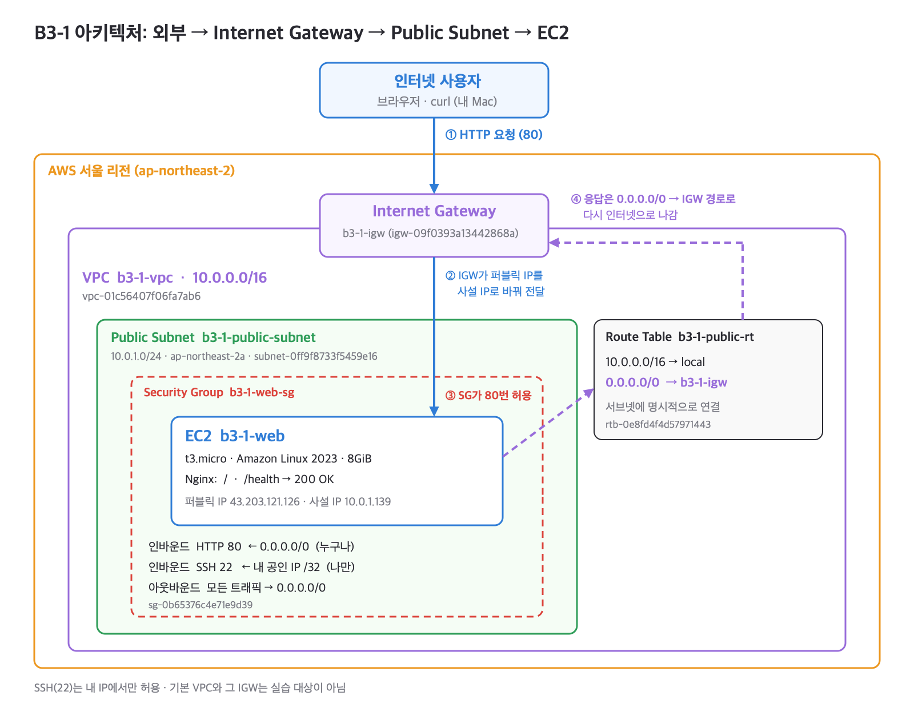
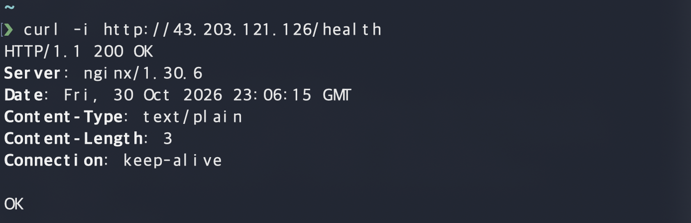
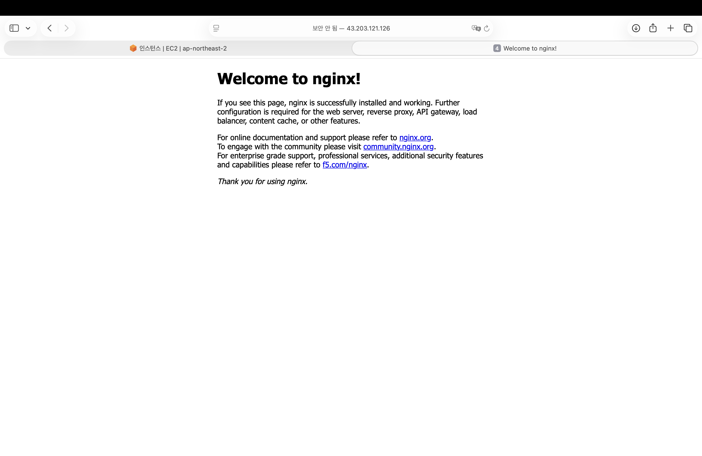
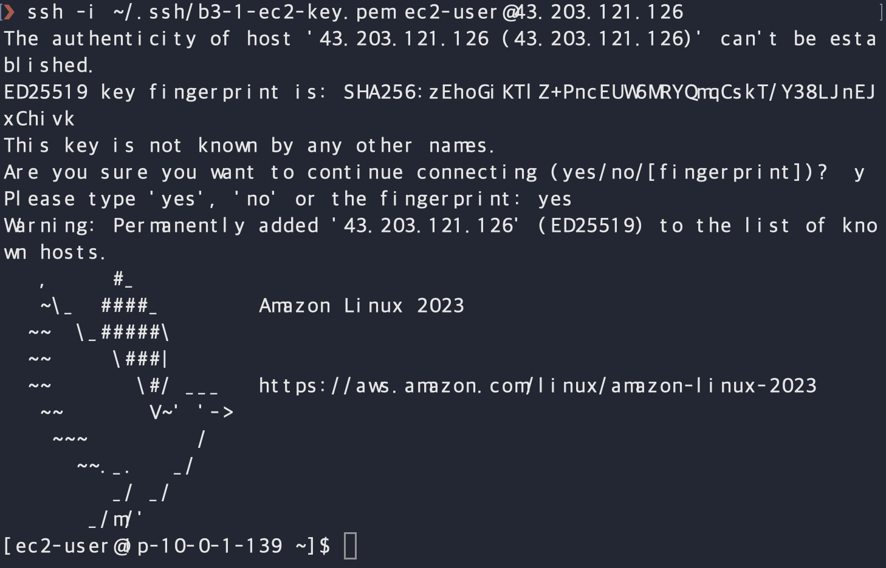
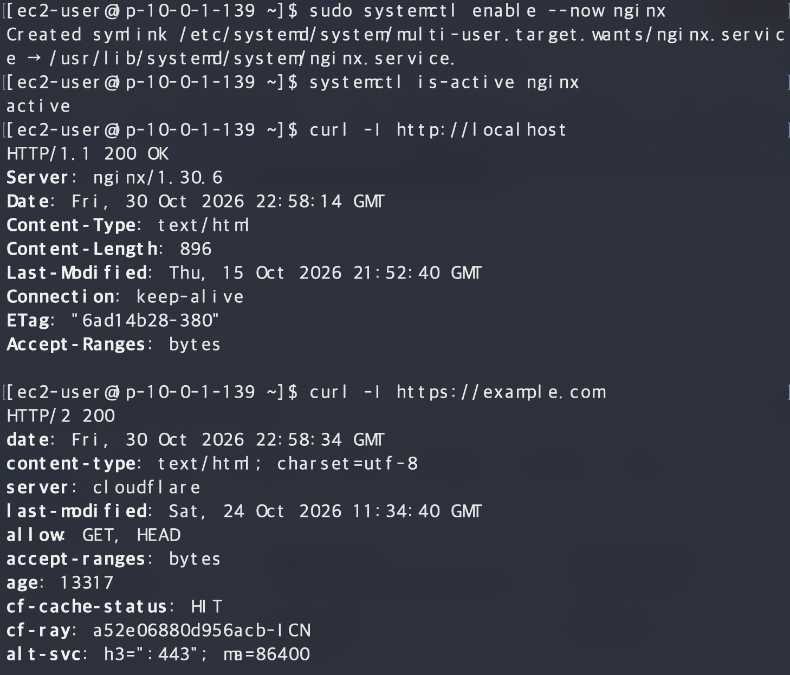
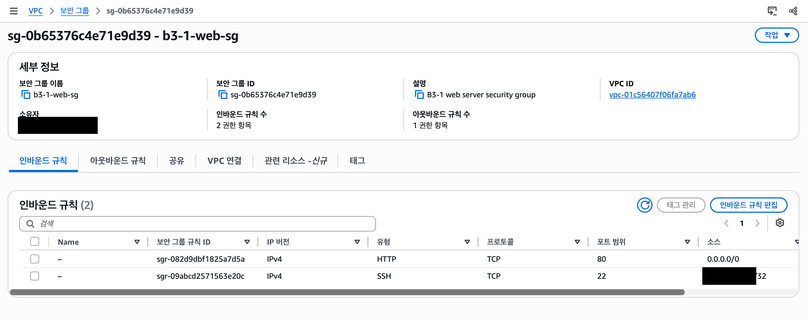

# B3-1 · 내가 만든 웹사이트를 인터넷에 올려 누구나 쓰게 하기

## 1. 아키텍처 다이어그램



### 네트워크 구성 설명

| 구성 요소 | 이름 | ID / 값 |
| --- | --- | --- |
| 리전 | 아시아 태평양 (서울) | `ap-northeast-2` |
| VPC | `b3-1-vpc` | `vpc-01c56407f06fa7ab6`, `10.0.0.0/16` |
| Public Subnet | `b3-1-public-subnet` | `subnet-0ff9f8733f5459e16`, `10.0.1.0/24`, `ap-northeast-2a` |
| Internet Gateway | `b3-1-igw` | `igw-09f0393a13442868a`, `b3-1-vpc`에 연결(Attached) |
| Route Table | `b3-1-public-rt` | `rtb-0e8fd4f4d57971443`, 서브넷에 명시적으로 연결 |
| Security Group | `b3-1-web-sg` | `sg-0b65376c4e71e9d39` |
| EC2 | `b3-1-web` | `i-0ea7601c076fbc132`, `t3.micro`, Amazon Linux 2023, 디스크 8GiB |

라우팅 테이블 `b3-1-public-rt`의 경로:

| 대상 | 타깃 | 뜻 |
| --- | --- | --- |
| `10.0.0.0/16` | `local` | VPC 안의 주소끼리는 내부에서 바로 통신함 |
| `0.0.0.0/0` | `igw-09f0393a13442868a` | 그 밖의 모든 주소는 인터넷 게이트웨이로 보냄 |

외부 요청이 웹 서버까지 가는 길:

1. 사용자가 `http://43.203.121.126`으로 요청을 보냄.
2. 요청은 인터넷을 지나 `b3-1-igw`를 통해 `b3-1-vpc`로 들어옴.
3. 인터넷 게이트웨이가 퍼블릭 IP `43.203.121.126`을 EC2의 사설 IP `10.0.1.139`로 바꿔서 `b3-1-public-subnet`의 EC2로 보냄.
4. `b3-1-web-sg`가 TCP 80번이라서 통과시킴.
5. EC2의 Nginx가 응답함.
6. 응답은 라우팅 테이블의 `0.0.0.0/0 → IGW` 경로를 따라 다시 인터넷으로 나감.

서브넷의 "퍼블릭 IPv4 주소 자동 할당"은 꺼져 있음. 그래서 EC2를 만들 때 "퍼블릭 IP 자동 할당"을 직접 켰음. 이것을 켜지 않으면 EC2가 사설 IP만 받아서 밖에서 접속할 수 없음.

## 2. 외부 접속 증빙

- 검증 방식: **B (GET /health)** 를 주 방식으로 하고, **A (브라우저)** 도 함께 확인함.
- 접속 주소: `http://43.203.121.126`, `http://43.203.121.126/health`
- 검증 시각: 2026-10-31 오전 8시쯤 (KST)
- 검증 위치: EC2가 아닌 내 Mac (외부)

### B. GET /health

```text
$ curl -i http://43.203.121.126/health
HTTP/1.1 200 OK
Server: nginx/1.30.6
Content-Type: text/plain
Content-Length: 3

OK
```



구성 방법: Nginx 기본 사이트에 `/health` 주소를 추가함. Amazon Linux 2023의 Nginx는 `/etc/nginx/default.d/` 폴더의 설정을 기본 서버에 포함하므로, 그 폴더에 파일을 하나 만들었음.

```nginx
# /etc/nginx/default.d/health.conf
location = /health {
    default_type text/plain;
    return 200 "OK\n";
}
```

- `location = /health`: 주소가 정확히 `/health`일 때만 이 규칙을 씀.
- `return 200 "OK\n"`: 파일을 찾지 않고 상태 코드 200과 고정 문구 `OK`를 바로 돌려줌.
- `sudo nginx -t`로 문법을 검사한 뒤 `sudo systemctl reload nginx`로 다시 읽게 함.

### A. 브라우저 접속

Safari에서 `http://43.203.121.126`을 열어 Nginx 기본 페이지를 확인함.



### 서버 안에서 확인한 것

| 확인 | 명령 | 결과 |
| --- | --- | --- |
| SSH 접속 | `ssh -i <키 파일> ec2-user@43.203.121.126` | 접속 성공 |
| Nginx 실행 | `systemctl is-active nginx` | `active` |
| 서버 내부 웹 응답 | `curl -I http://localhost` | `HTTP/1.1 200 OK` |
| 서버에서 밖으로 나가는 통신 | `curl -I https://example.com` | `HTTP/2 200` |





## 3. 보안 및 권한 관리

### Security Group (`b3-1-web-sg`)

| 방향 | 포트 | 허용 범위 | 이유 |
| --- | --- | --- | --- |
| 들어오는 규칙 | TCP 80 (HTTP) | `0.0.0.0/0` | 누구나 웹 페이지를 볼 수 있어야 함 |
| 들어오는 규칙 | TCP 22 (SSH) | 내 공인 IP 한 개 (`/32`) | 서버 관리는 나만 해야 함. IP 값은 공개하지 않음 |
| 나가는 규칙 | 모든 트래픽 | `0.0.0.0/0` | Nginx 설치, `curl https://example.com` 등 서버가 밖으로 나가는 통신에 필요 |



- 그 밖의 포트(HTTPS 443, DB 포트 등)는 쓰지 않으므로 열지 않았음.
- `0.0.0.0/0`에 모든 포트(0-65535)를 여는 규칙은 만들지 않았음.
- VPC에 자동으로 생기는 `default` 보안 그룹은 쓰지 않았음.

### IAM

- 실습용 IAM 사용자: `codyssey-b3-1-student`
  - 콘솔 작업은 모두 이 사용자로 했음. VPC, 보안 그룹, 키 페어, EC2를 모두 이 사용자로 만들었음.
- 연결한 정책: 고객 관리형 정책 `B3-1-Network-Setup` ([정책 JSON](docs/iam-policy.json))
  - EC2 조회는 서울 리전으로만 제한함.
  - EC2는 `t2.micro`/`t3.micro`, 디스크 10GiB 이하, `b3-1-public-subnet`에서만 만들 수 있음.
  - 보안 그룹은 `b3-1-vpc` 안에서만 만들고 고칠 수 있음.
  - 삭제는 이 실습의 VPC·서브넷·라우팅 테이블·인터넷 게이트웨이 ID로만 제한함. 그래서 기본 VPC는 지울 수 없음.
  - S3, RDS 같은 다른 서비스 권한과 IAM 권한은 넣지 않았음.
- `AdministratorAccess`: 부여하지 않음.
  - 근거: 실습 사용자로 IAM 사용자 목록을 열었을 때 `iam:ListUsers` 권한이 없다는 거부가 나왔음. 관리자 권한이 있었다면 열렸을 것임.
  - 한계: 루트 화면에서 이 사용자의 "권한" 탭을 직접 열어 확인하지는 않았음.
- `docs/iam-policy.json`은 2026-10-30 콘솔에 붙여넣은 v3 내용이며, 계정 ID 자리는 `*`로 바꿔 두었음.

### 루트 계정 사용 기록

실습 사용자는 자기 권한을 고칠 수 없고, 계정에 다른 IAM 사용자가 없어서 **정책 수정에만 루트 계정을 썼음.** 미션은 "루트 계정은 사용하지 않는다"고 정하고 있어서, 이 조건과 맞지 않을 수 있는 부분을 그대로 기록함.

| 날짜 (KST) | 한 일 |
| --- | --- |
| 2026-10-28 | 정책 JSON 확인, 보안 그룹 권한을 추가한 v2 저장 |
| 2026-10-30 08:40~08:50 | IAM 사용자가 1명뿐임을 확인, EC2·정리 권한을 넣은 v3 저장 |

자세한 경위는 [트러블슈팅 보고서](docs/troubleshooting.md)에 있음.

### 리소스 추적 기준

- 이름: 이번 실습에서 만든 리소스는 모두 `b3-1-` 로 시작함.
- 태그: 보안 그룹과 EC2에는 `Project=codyssey-b3-1`을 붙였음. VPC·서브넷·IGW·라우팅 테이블에는 이름(`Name`) 태그만 있고 `Project` 태그는 없음.
- ID: 위 표의 리소스 ID를 [정리 체크리스트](docs/cleanup-checklist.md)와 대조해서 지움.
- 기본 VPC와 그 인터넷 게이트웨이는 실습 리소스가 아니므로 지우지 않음.

## 4. 트러블슈팅

[트러블슈팅 보고서](docs/troubleshooting.md)

- 사례 1: 보안 그룹을 만들 수 없음 (`ec2:CreateSecurityGroup` 권한 부족) → 해결

## 5. 리소스 정리

[리소스 정리 체크리스트](docs/cleanup-checklist.md)
