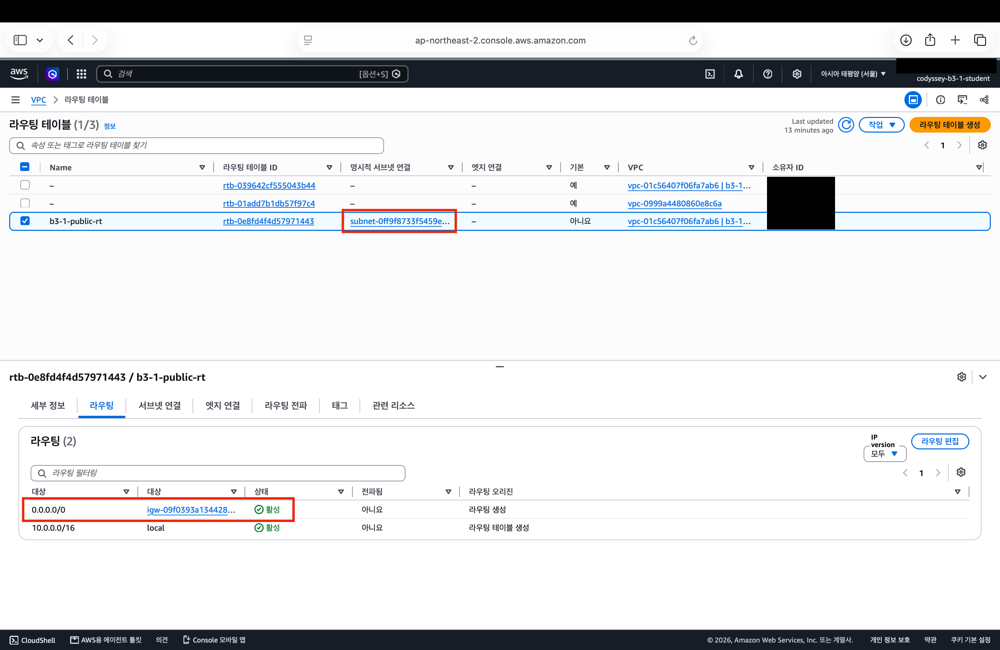
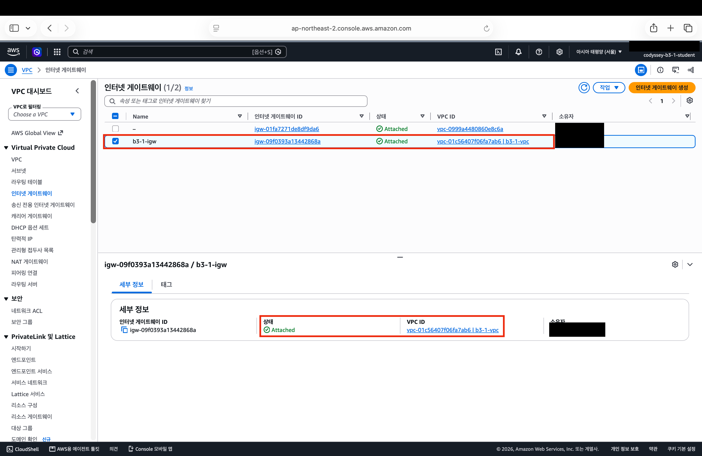
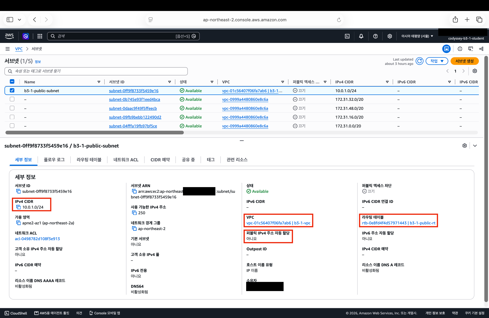

# 항목 1 — 구성과 동작 증거 (E01~E05)

평가자에게 보여 줄 스크린샷 모음이다. 이미지는 `img/evidence/`에 있고, 계정 ID와 내 공인 IP는 가렸다. 빨간 테두리는 볼 곳을 표시하려고 나중에 그린 것이다.

## B3-1-E01

> VPC, Public Subnet, Internet Gateway, Route Table(0.0.0.0/0 → IGW)이 구성되어 있는가?

| 스크린샷 | 보여 주는 것 | 상태 |
| --- | --- | --- |
| `e01-vpc-resource-map.png` | VPC와 서브넷·라우팅 테이블·IGW의 연결 | 있음 |
| `e01-subnet.png` | 서브넷의 VPC, IPv4 CIDR, 라우팅 테이블 | 있음 |
| `e01-igw.png` | IGW가 `b3-1-vpc`에 연결됨(Attached) | 있음 |
| `e01-route-table-routes.png` | `0.0.0.0/0 → IGW` 경로가 활성, 서브넷이 이 테이블에 명시적으로 연결됨 | 있음 |

리소스 맵의 라우팅 테이블 2개 중 `rtb-039642cf555043b44`는 VPC를 만들 때 자동으로 생긴 기본(main) 라우팅 테이블이고, 서브넷과 연결되지 않았다. 서브넷은 `b3-1-public-rt`에 연결되어 있다.

- 아래쪽 "라우팅" 표: `0.0.0.0/0`의 대상이 `igw-09f0393a13442868a`(`b3-1-igw`)이고 상태가 활성이다.
- 위쪽 목록의 `b3-1-public-rt` 줄: "명시적 서브넷 연결"이 `subnet-0ff9f8733f5459e16`(`b3-1-public-subnet`)이고, "기본"이 아니요다.

- `b3-1-igw`(`igw-09f0393a13442868a`)의 상태가 Attached이고, VPC가 `b3-1-vpc`다.
- 이름 없는 다른 IGW는 기본 VPC(`vpc-0999a4480860e8c6a`)의 것이며 실습 리소스가 아니다.

- `b3-1-public-subnet`(`subnet-0ff9f8733f5459e16`)의 IPv4 CIDR이 `10.0.1.0/24`, VPC가 `b3-1-vpc`, 라우팅 테이블이 `b3-1-public-rt`다.
- "퍼블릭 IPv4 주소 자동 할당"은 아니요다. 그래서 EC2를 만들 때 퍼블릭 IP 자동 할당을 직접 켰다.
- 목록의 나머지 서브넷 4개는 기본 VPC(`vpc-0999a4480860e8c6a`)의 것이다.

## B3-1-E02

> EC2에 SSH로 접속 가능하며, 웹 서버가 실행 중인가?

| 스크린샷 | 보여 주는 것 | 상태 |
| --- | --- | --- |
| `e02-instance-detail.png` | 인스턴스 ID, 실행 중, 유형, 서브넷, 퍼블릭 IP | 미첨부 |
| `e02-ssh-connected.png` | SSH 접속 성공 | 있음 |
| `e02-server-checks.png` | Nginx 실행, `localhost` 200, 서버에서 밖으로 나가는 통신 200 | 있음 |

## B3-1-E03

> 보안 그룹 인바운드가 필요 포트만 허용하며, SSH(22)가 특정 IP로 제한되어 있는가?

| 스크린샷 | 보여 주는 것 | 상태 |
| --- | --- | --- |
| `e03-inbound-rules.png` | HTTP 80 ← `0.0.0.0/0`, SSH 22 ← IP 한 개(`/32`) | 있음 |
| `e03-ec2-security.png` | EC2에 붙은 보안 그룹이 `b3-1-web-sg` 하나뿐 | 미첨부 |

## B3-1-E04

> 외부 접속이 다음 중 한 가지 방식으로 검증되는가? (A) 브라우저 http://<퍼블릭IP> 접속 시 페이지 정상 로딩 / (B) GET /health 호출 시 200 및 고정 응답 확인

| 스크린샷 | 보여 주는 것 | 상태 |
| --- | --- | --- |
| `e04-health-check.png` | (B) 내 Mac에서 `GET /health` → 200, `OK` | 있음 |
| `e04-browser-access.png` | (A) 브라우저에서 Nginx 페이지 | 있음 |

선택한 방식(B 주, A 함께)과 접속 주소, `/health` 설정은 [README](../../README.md)의 "2. 외부 접속 증빙"에 있음.

## B3-1-E05

> 리소스 정리 체크리스트에서 최소 5종(EC2/EBS/EIP/IGW/VPC) 정리 완료를 확인할 수 있는가?

| 스크린샷 | 보여 주는 것 | 상태 |
| --- | --- | --- |
| `e05-ec2-terminated.png` | `b3-1-web`이 종료됨 | 미첨부 |
| `e05-volumes-empty.png` | 볼륨 목록이 비어 있음 | 미첨부 |
| `e05-eip-empty.png` | 탄력적 IP 목록이 비어 있음(만든 적 없음) | 미첨부 |
| `e05-nat-empty.png` | NAT 게이트웨이 목록이 비어 있음(만든 적 없음) | 미첨부 |
| `e05-igw-deleted.png` | `b3-1-igw`가 없음 | 미첨부 |
| `e05-vpc-deleted.png` | `b3-1-vpc`가 없음 | 미첨부 |

자세한 정리 기록은 [정리 체크리스트](../cleanup-checklist.md)에 있다.
