# 항목 1 — 구성과 동작 증거 (E01~E05)

## B3-1-E01

> VPC, Public Subnet, Internet Gateway, Route Table(0.0.0.0/0 → IGW)이 구성되어 있는가?

#### 0. 구조

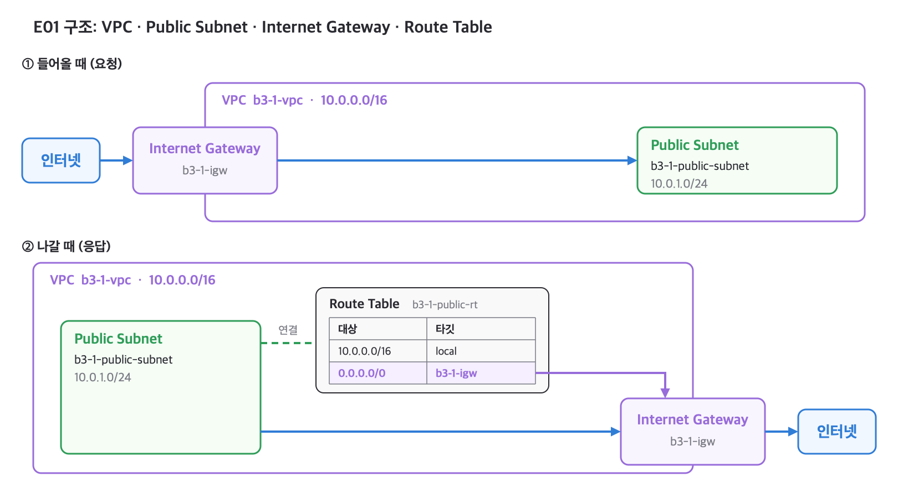

#### 1. VPC — `b3-1-vpc`

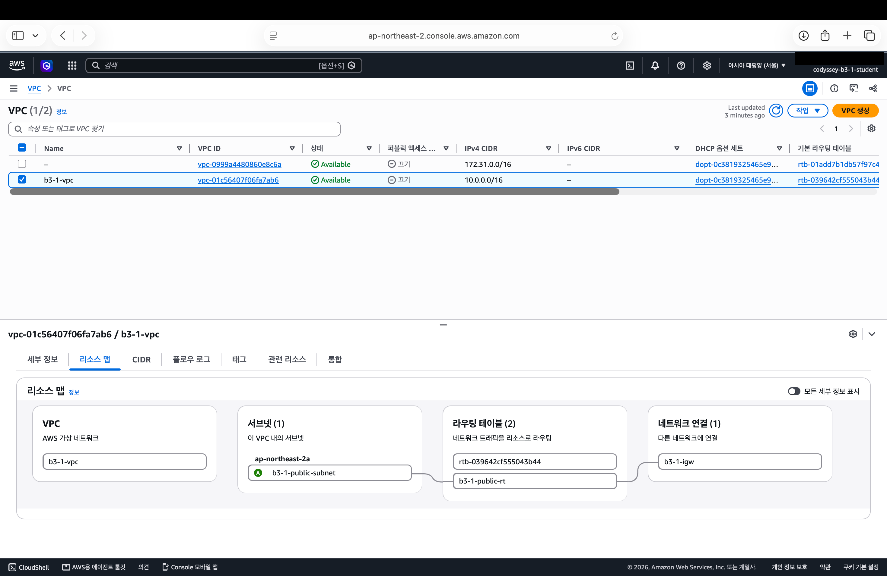

- 선으로 이어진 내 서브넷, 라우팅 테이블, 인터넷 게이트웨이

#### 2. Public Subnet — `b3-1-public-subnet`

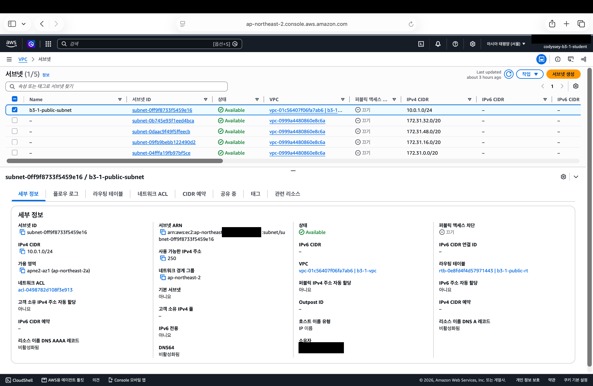

- 주소 범위(IPv4 CIDR), 속한 VPC, 퍼블릭 IP 자동 할당 여부, 연결된 라우팅 테이블
- 이 서브넷은 인터넷 주소(퍼블릭 IP)를 자동으로 주지 않는다. 그래서 EC2를 만들 때 직접 받도록 켰다.

#### 3. Internet Gateway — `b3-1-igw`

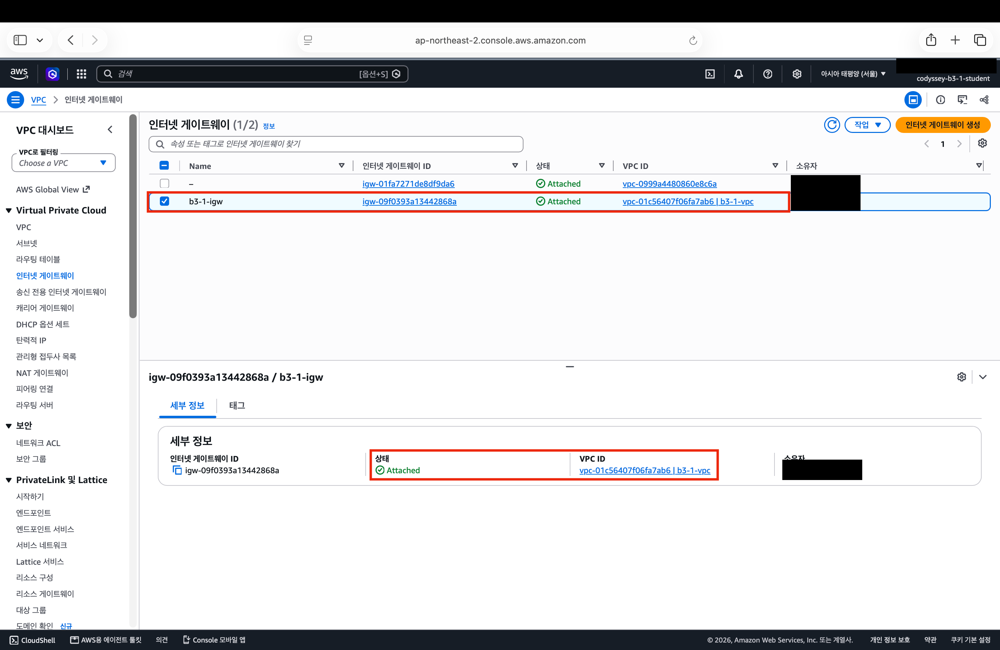

- `b3-1-igw`의 상태와 붙어 있는 VPC

#### 4. Route Table — `b3-1-public-rt`

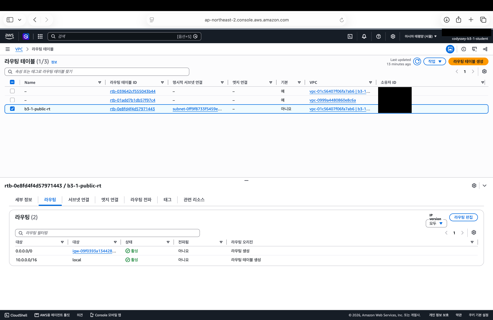

- 연결된 서브넷(위), `0.0.0.0/0` 경로의 대상과 상태(아래)

## B3-1-E02

> EC2에 SSH로 접속 가능하며, 웹 서버가 실행 중인가?

#### 1. EC2 — `b3-1-web`

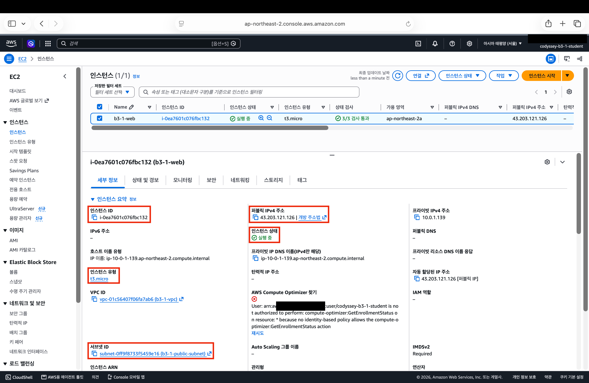

- 인스턴스 ID, 상태, 유형, 퍼블릭 IP, 서브넷

#### 2. SSH 접속 — `ec2-user@43.203.121.126`

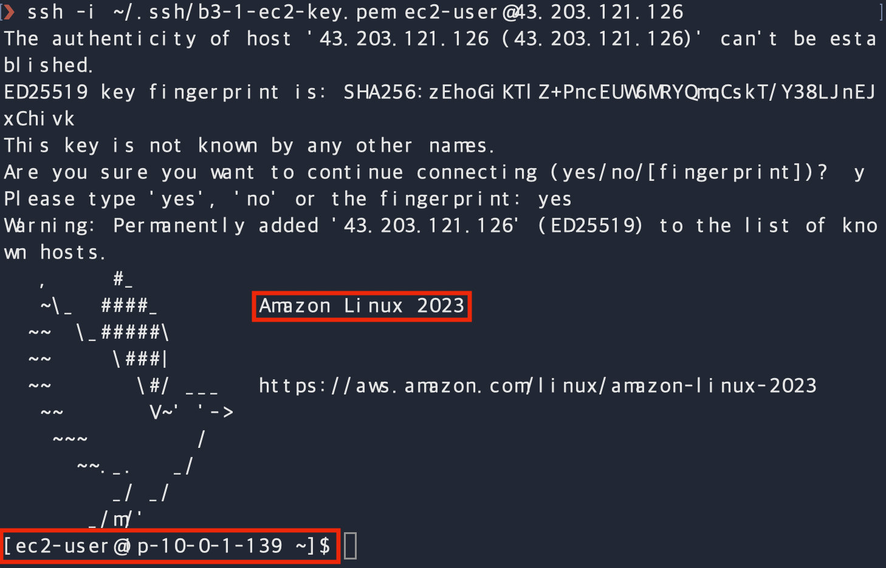

- 접속한 서버의 운영체제, 서버 안에서 명령을 기다리는 줄(프롬프트)

#### 3. 웹 서버 — Nginx

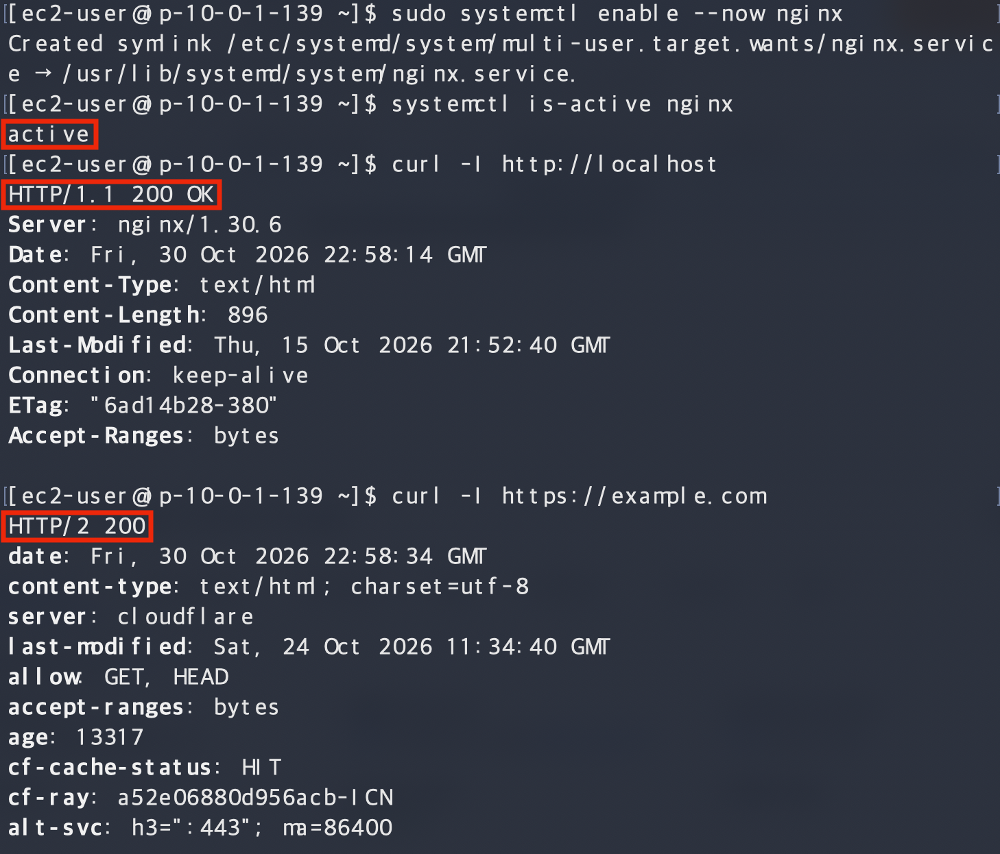

- 위에서부터 Nginx 실행 상태, `localhost` 요청 결과, `example.com` 요청 결과
- 사진 속 시각은 한국 시간으로 10월 31일 오전 7시 58분이다.

## B3-1-E03

> 보안 그룹 인바운드가 필요 포트만 허용하며, SSH(22)가 특정 IP로 제한되어 있는가?

#### 1. 인바운드 규칙 — `b3-1-web-sg`

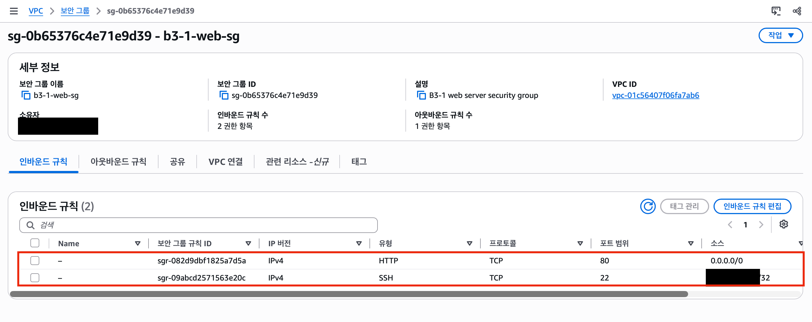

- 인바운드 규칙 두 줄(HTTP 80, SSH 22)

#### 2. EC2에 붙은 보안 그룹 — `b3-1-web`

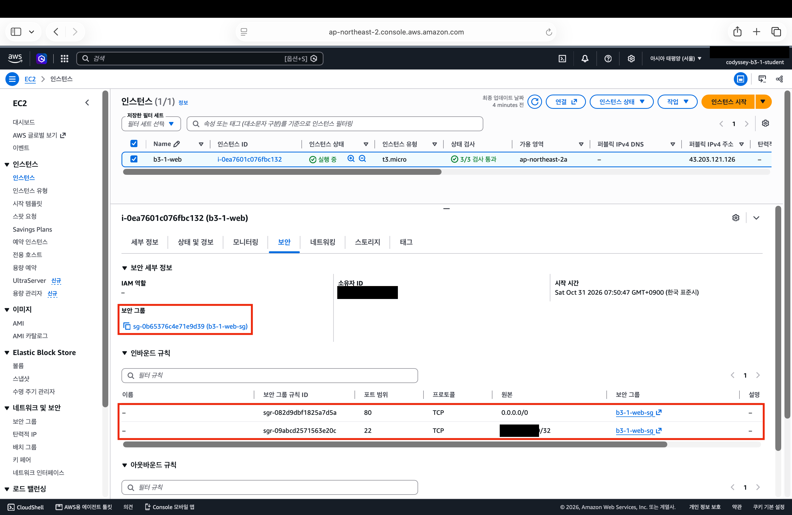

- EC2에 붙은 보안 그룹, 그 보안 그룹의 인바운드 규칙 두 줄

## B3-1-E04

> 외부 접속이 다음 중 한 가지 방식으로 검증되는가? (A) 브라우저 http://<퍼블릭IP> 접속 시 페이지 정상 로딩 / (B) GET /health 호출 시 200 및 고정 응답 확인

#### 1. (B) `GET /health` — `http://43.203.121.126/health`

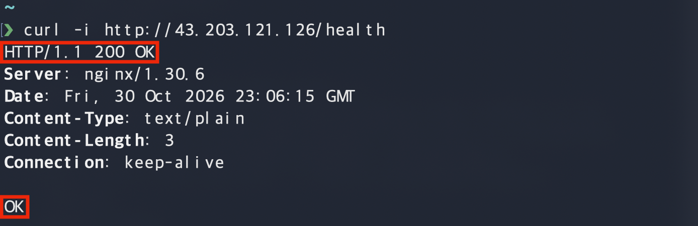

- 응답 상태 코드, 응답 내용
- 내 Mac에서 실행했다.
- 사진 속 시각은 한국 시간으로 10월 31일 오전 8시 6분이다.

#### 2. (A) 브라우저 접속 — `http://43.203.121.126`

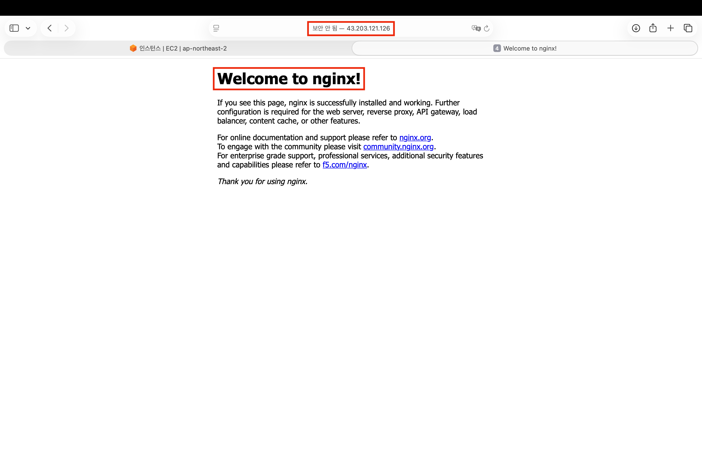

- 접속한 주소, 화면에 뜬 페이지 제목

B를 주로 썼고, A도 함께 확인했다. `/health` 설정은 [README](../../README.md)의 "2. 외부 접속 증빙"에 있다.

## B3-1-E05

> 리소스 정리 체크리스트에서 최소 5종(EC2/EBS/EIP/IGW/VPC) 정리 완료를 확인할 수 있는가?

2026-11-16 오후 2시 39분 ~ 3시 43분에 `codyssey-b3-1-student`로 정리했다.

#### 1. EC2 — `b3-1-web`

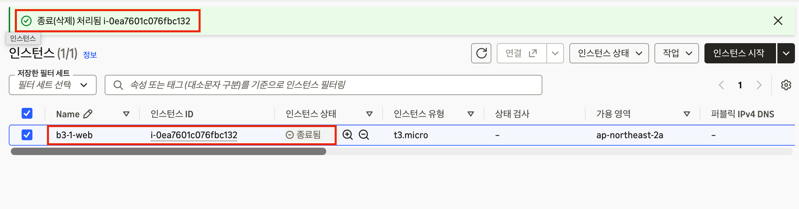

- 종료 알림, 인스턴스 상태

#### 2. EBS — 루트 볼륨 `vol-01d31ad9c160d8f73`

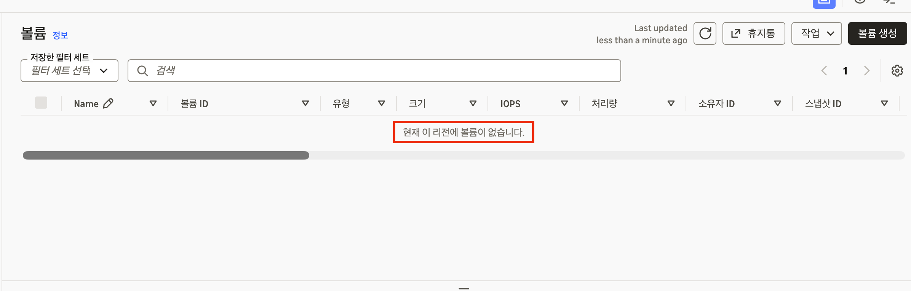

- 볼륨 목록
- 정리 전에 이 볼륨의 "종료 시 삭제"가 "예"인 것을 확인했다. 그래서 서버를 지울 때 함께 지워졌다.

#### 3. EIP — 만든 적 없음

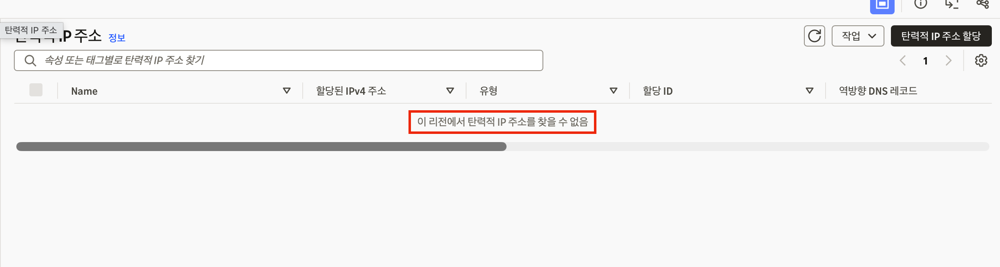

- 탄력적 IP 목록
- 퍼블릭 IP는 EC2를 만들 때 자동으로 받은 것이라, 서버를 지우면서 함께 반납됐다.

#### 4. Internet Gateway — `b3-1-igw`

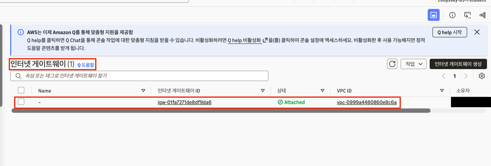

- 남은 인터넷 게이트웨이 수, 남은 하나(기본 VPC 것)
- VPC에서 분리한 뒤 삭제했다.

#### 5. VPC — `b3-1-vpc`

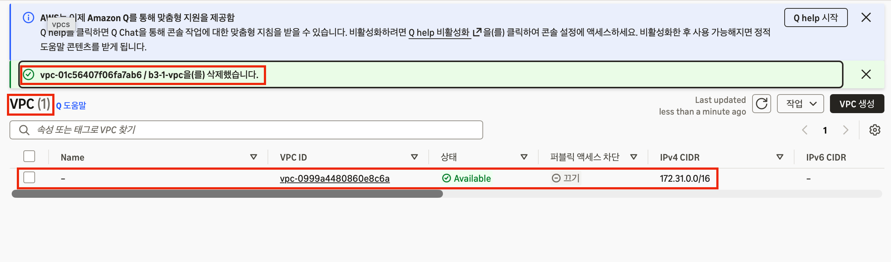

- 삭제 알림, 남은 VPC 수, 남은 하나(기본 VPC)
- 서브넷과 라우팅 테이블을 먼저 지운 뒤 삭제했다.

#### 6. NAT Gateway — 만든 적 없음

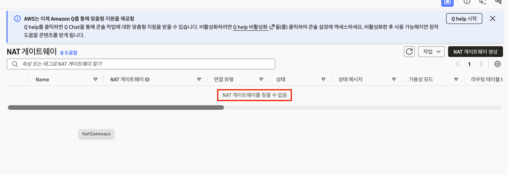

- NAT 게이트웨이 목록

보안 그룹, 키 페어, 내 컴퓨터의 키 파일도 지웠다. 순서와 시각은 [정리 체크리스트](../cleanup-checklist.md)에 있다.
