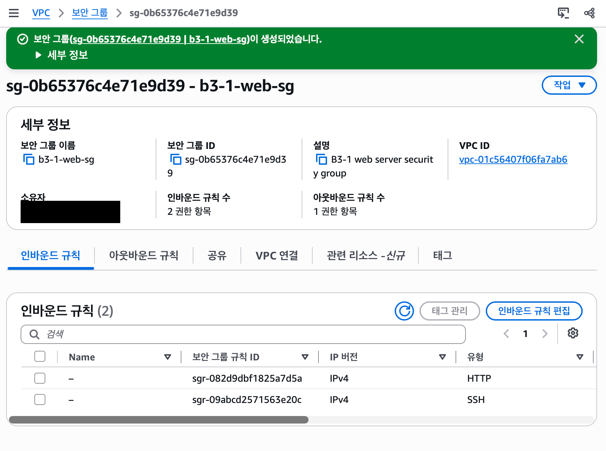

# B3-1 트러블슈팅 보고서

## 사례 목록

| 사례 | 제목 | 이미지 폴더 | 상태 |
| --- | --- | --- | --- |
| 1 | 보안 그룹을 만들 수 없음 (권한 부족) | [01-security-group-permission](../img/troubleshooting/01-security-group-permission/) | 해결 |

## 사례 1. 보안 그룹을 만들 수 없음 (권한 부족)

> 보안 그룹: 서버 앞에 세우는 문지기. 어떤 접속을 들여보낼지 정함.
> IAM 권한: AWS 계정 안에서 "이 사용자는 무엇을 해도 되는지" 적어 둔 허가증.

### 1. 문제 상황

- 언제: 2026-10-27 오전 8시쯤 (오류 화면을 캡처한 시각 기준)
- 무엇을 하려 했나: 실습용 사용자 `codyssey-b3-1-student`로 웹 서버용 보안 그룹 `b3-1-web-sg`를 만들려고 했음.
  - 웹 접속(HTTP, 80번)은 누구나 허용
  - 원격 접속(SSH, 22번)은 내 IP만 허용
  - 서버에서 밖으로 나가는 통신은 모두 허용

  

- 무슨 일이 생겼나: 만들기 버튼을 누르자 아래 오류가 나왔음.

  ```text
  User: ...user/codyssey-b3-1-student is not authorized to perform:
  ec2:CreateSecurityGroup ... because no identity-based policy allows
  the ec2:CreateSecurityGroup action.
  ```

  쉽게 말해 "이 사용자에게는 보안 그룹을 만들 허가가 없다"는 뜻임.

  

### 2. 원인 추측

- 보안 그룹 설정을 잘못 넣은 게 아니라, 사용자에게 보안 그룹을 만들 권한이 없는 것으로 보임.
- 이유:
  - 오류 메시지가 `ec2:CreateSecurityGroup` 권한이 없다고 직접 말하고 있음.
  - 앞서 붙여 둔 `B3-1-Network-Setup` 정책은 VPC·서브넷 같은 네트워크를 만드는 용도였고, 보안 그룹 권한은 넣으려고 한 적이 없음.

### 3. 확인한 것

- 화면 오른쪽 위에서 로그인한 사용자(`codyssey-b3-1-student`)와 리전(서울)을 확인했음.
- 오류 메시지에 권한이 없다고 적힌 것은 확인했음.
- 오류 당시에는 `B3-1-Network-Setup` 정책 내용(JSON)을 열어 보지 않았음.
- 이후 정책 JSON을 직접 열어 보니 `ec2:CreateSecurityGroup`이 없었음. 원인 추측이 맞았음.

### 4. 해결 방법

권한 문제라서 다시 시도(Retry)해도 같은 오류가 날 것이므로 누르지 않았음.

실습용 사용자는 자기 권한을 볼 수도, 고칠 수도 없음. 계정에 IAM 사용자는 이 사용자 하나뿐이라, **정책 수정에는 루트 계정을 썼음.** 처음에는 "별도 계정"으로 고치고 루트는 쓰지 않을 계획이었지만, 그런 계정이 없었음.

| 날짜 (KST) | 로그인 | 한 일 |
| --- | --- | --- |
| 2026-10-28 | 루트 | 정책 JSON 확인, 보안 그룹 권한을 추가한 v2 저장 |
| 2026-10-30 08:40~08:50 | 루트 | IAM 사용자가 1명뿐임을 확인. EC2 생성·조회·정리 권한까지 넣은 v3 저장 |

보안 그룹에 추가한 권한 (v2):

| 추가한 권한 | 하는 일 |
| --- | --- |
| `ec2:CreateSecurityGroup` | 보안 그룹 만들기 (`b3-1-vpc` 안에서만) |
| `ec2:AuthorizeSecurityGroupIngress` | 들어오는 규칙 추가 |
| `ec2:AuthorizeSecurityGroupEgress` | 나가는 규칙 추가 |
| `ec2:RevokeSecurityGroupIngress` | 잘못 넣은 들어오는 규칙 지우기 |
| `ec2:RevokeSecurityGroupEgress` | 잘못 넣은 나가는 규칙 지우기 |
| `ec2:DeleteSecurityGroup` | 실습이 끝난 뒤 보안 그룹 삭제 |
| `ec2:CreateTags` | 보안 그룹을 만들 때 태그 붙이기 |

- 모든 권한을 주는 관리자 권한(`AdministratorAccess`)은 쓰지 않았음. 필요한 만큼만 주는 것이 안전하기 때문임.
- 루트 계정은 정책 수정에만 썼고, VPC·보안 그룹·EC2 같은 실습 리소스는 모두 `codyssey-b3-1-student`로 만들었음.
- 미션은 "루트 계정은 사용하지 않는다"고 정하고 있음. 루트를 정책 수정에 쓴 것은 이 조건과 맞지 않을 수 있어서, 날짜와 목적을 위에 그대로 적어 둠.

### 5. 결과

- 확인 방법: 실습용 사용자로 같은 설정의 보안 그룹을 다시 만들어 봄.
- 결과: 2026-10-31 오전 7시 35분, `codyssey-b3-1-student`로 `b3-1-web-sg`(`sg-0b65376c4e71e9d39`) 생성 성공. `b3-1-vpc` 안에 만들어졌고, 들어오는 규칙 2개(HTTP, SSH), 나가는 규칙 1개가 들어감.

  

- 해결 여부: 해결

### 6. 다음에 같은 문제를 막으려면

- 작업을 시작하기 전에 그 작업에 필요한 권한이 있는지 먼저 확인함.
- 권한 오류가 나면 바로 다시 시도하지 말고, 오류 메시지에 적힌 권한 이름부터 읽음.
- 다음 단계(서버 만들기, 실습 후 정리)에 필요한 권한도 미리 점검함. 그래서 v3에서는 EC2 생성과 정리 권한까지 한 번에 넣어, 루트 로그인 횟수를 줄였음.
- 화면 표시용 조회 권한이 없다는 오류(예: `ec2:DescribeNatGateways`)는 실제 작업을 막는지 먼저 확인함. 막지 않으면 그 오류 때문에 권한을 늘리지 않음. (v3에서 조회 권한 `ec2:Describe*`를 넣은 이유는 이 오류가 아니라, 인스턴스·볼륨 같은 비용 리소스를 직접 확인해야 했기 때문임.)

---

※ 실제로 겪은 오류만 기록함. 4·5번은 직접 해 보고 확인한 뒤에만 고침.
